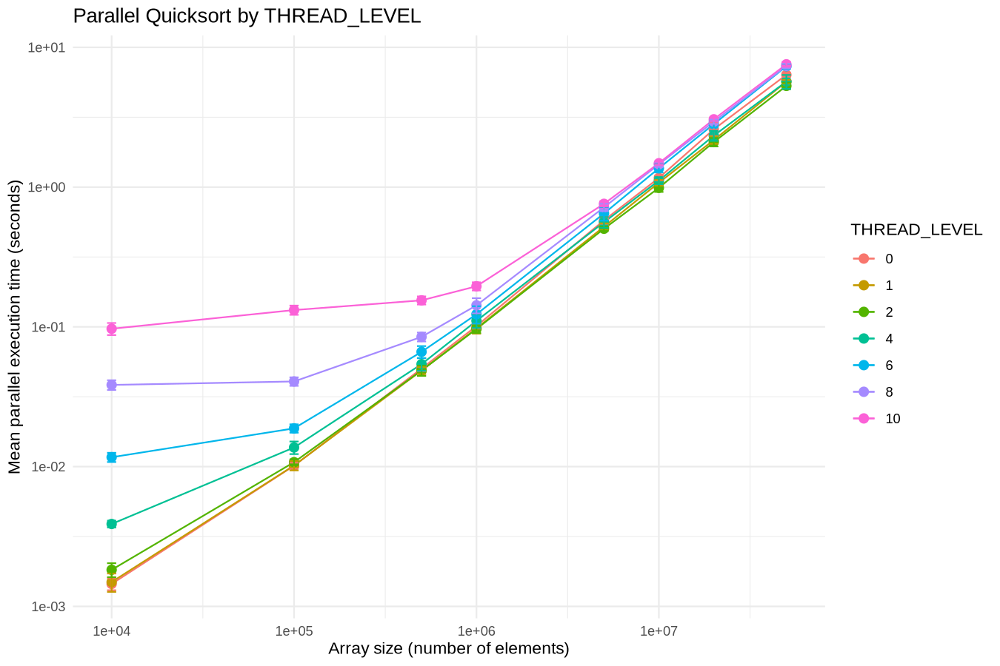
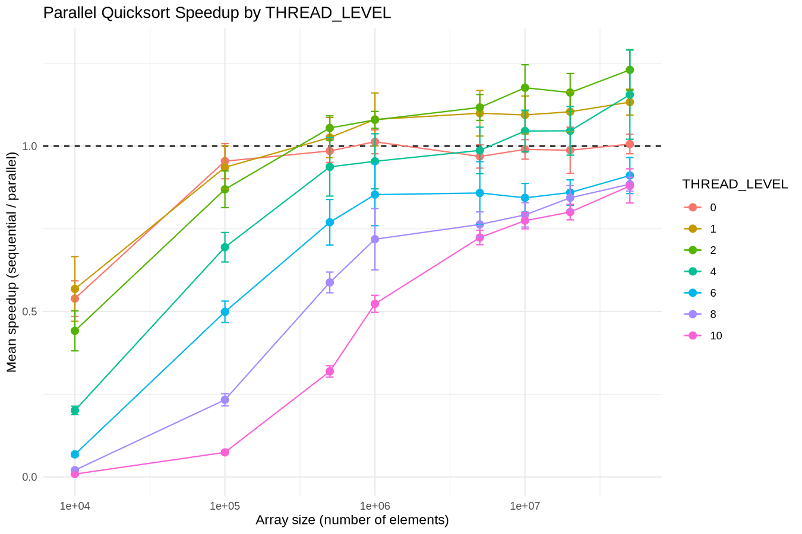

# Analyse des performances

## 1. Configuration expérimentale

Les benchmarks ont été réalisés sous **Linux dans WSL2** sur une machine équipée d'un **AMD Ryzen 7 6800HS Creator Edition**. WSL2 expose 8 cœurs physiques et 16 processeurs logiques. La mémoire visible est de 6,6 Gio, avec 2 Gio de swap. Le programme a été compilé avec **GCC 16.2.0** et les options `-O2 -Wall -g`.

Le benchmark compare trois méthodes de tri : le tri séquentiel, notre implémentation de tri parallèle et `qsort` fourni par la bibliothèque standard C.

Pour le tri parallèle, plusieurs niveaux de récursion ont été testés :

```text
THREAD_LEVEL = 0, 1, 2, 4, 6, 8, 10
```

Chaque configuration a été exécutée **10 fois** sur des tableaux de 10 000 à 50 millions d'éléments.

Les résultats sont analysés à partir de la **moyenne**, de l'**écart-type** et d'un **intervalle de confiance à 95 % de la moyenne**. L'intervalle de confiance est calculé avec la loi de Student à partir des 10 répétitions. (formule : \(\bar{x} \pm t_{0.975,n-1}\frac{s}{\sqrt{n}}\), ou \(\bar{x}\) est la moyenne, \(s\) l'ecart-type et \(n\) le nombre de repetitions)

## 2. Fichiers ajoutés

### Benchmark

- `scripts/benchmark_improved.sh` : lance automatiquement les benchmarks pour les différentes tailles, les niveaux de `THREAD_LEVEL` et le nombre de répétitions.
- `src/parallelQuicksort.c` : permet de définir la taille du tableau et le `THREAD_LEVEL` directement depuis la ligne de commande.

### Analyse statistique

- `scripts/analyse_benchmark.R`: calcule les moyennes, les écarts-types, les intervalles de confiance à 95 %, les speedups et le meilleur `THREAD_LEVEL`.
- `data/benchmark_*.csv` : contient les mesures brutes produites par les benchmarks.
- `data/analysis/statistiques_thread_level.csv` : contient les statistiques calculées pour chaque taille et chaque `THREAD_LEVEL`.
- `data/analysis/best_thread_level.csv` : contient le meilleur `THREAD_LEVEL` identifié pour chaque taille.

### Visualisations

- `data/analysis/parallel_thread_levels.png` : évolution des performances du tri parallèle selon `THREAD_LEVEL`.
- `data/analysis/speedup_thread_levels.png` : évolution du speedup selon la taille du tableau et le `THREAD_LEVEL`.

Les fichiers CSV et les graphiques sont générés automatiquement à partir des mesures du benchmark.

## 3. Lancement du benchmark

Le benchmark est lancé avec le nombre de répétitions souhaité :

```bash
./scripts/benchmark_improved.sh 10
```

Le fichier CSV généré est ensuite utilisé pour l'analyse :

```bash
Rscript scripts/analyse_benchmark.R data/benchmark_20261111_180819.csv
```

Le script calcule les moyennes, les écarts-types, les intervalles de confiance à 95 %, les speedups et le meilleur `THREAD_LEVEL` pour chaque taille.

## 4. Influence de `THREAD_LEVEL`



*Figure 2 - Temps d'exécution du tri parallèle pour les différents niveaux de `THREAD_LEVEL`.*

Les résultats montrent que le meilleur niveau dépend de la taille du tableau. Pour les petites tailles, un faible niveau de récursion est préférable. À partir de 500 000 éléments, `THREAD_LEVEL = 2` devient généralement le meilleur choix.

| Taille      | Meilleur `THREAD_LEVEL` | Speedup moyen |
|:------------|:-----------------------:|--------------:|
| 10 000      | 1                       | 0,568         |
| 100 000     | 0                       | 0,954         |
| 500 000     | 2                       | 1,055         |
| 1 000 000   | 1                       | 1,081         |
| 5 000 000   | 2                       | 1,117         |
| 10 000 000  | 2                       | 1,176         |
| 20 000 000  | 2                       | 1,162         |
| 50 000 000  | 2                       | 1,230         |

Pour 100 000 éléments, THREAD_LEVEL = 0 donne le meilleur résultat parmi les niveaux testés. Cela correspond au cas séquentiel et montre que le parallélisme n'apporte pas de gain pour cette taille.

Pour les petits tableaux, le travail à effectuer est trop faible pour que la création de plusieurs threads soit intéressante. Pour les grandes tailles, le temps de calcul devient suffisamment important pour compenser ce coût.

## 5. Speedup



*Figure 3 - Speedup moyen du tri parallèle par rapport au tri séquentiel.*

Le speedup est calculé par :

```text
speedup = temps séquentiel / temps parallèle
```
Un speedup égal à 1 signifie que les deux méthodes ont le même temps d'exécution. Au-dessus de 1, le tri parallèle est plus rapide ; en dessous de 1, il est plus lent.

Les meilleurs résultats obtenus pour chaque taille sont :

| Taille      | `THREAD_LEVEL` | Speedup moyen | IC 95 % |
|:------------|:--------------:|--------------:|:-------:|
| 10 000      | 1              | 0,568         | [0,470 ; 0,666] |
| 100 000     | 0              | 0,954         | [0,901 ; 1,008] |
| 500 000     | 2              | 1,055         | [1,018 ; 1,091] |
| 1 000 000   | 1              | 1,081         | [1,001 ; 1,161] |
| 5 000 000   | 2              | 1,117         | [1,078 ; 1,156] |
| 10 000 000  | 2              | 1,176         | [1,107 ; 1,246] |
| 20 000 000  | 2              | 1,162         | [1,104 ; 1,219] |
| 50 000 000  | 2              | **1,230**     | **[1,169 ; 1,292]** |

Pour 10 000 éléments, le meilleur speedup moyen est seulement de **0,568** avec `THREAD_LEVEL = 1`. Le parallélisme est donc clairement défavorable pour cette taille.

À 100 000 éléments, le meilleur niveau testé est `THREAD_LEVEL = 0`, avec un speedup moyen de **0,954**. L'intervalle de confiance contient `1`, ce qui signifie qu'il n'y a pas de gain statistiquement clair par rapport au tri séquentiel.

À partir de 500 000 éléments, le meilleur speedup devient supérieur à `1`. Pour 500 000 éléments, le speedup moyen atteint **1,055** avec `THREAD_LEVEL = 2`. L'intervalle de confiance `[1,018 ; 1,091]` est entièrement supérieur à `1`, ce qui indique un gain en faveur du tri parallèle dans cette configuration.

Pour 1 million d'éléments, le speedup moyen est de 1,081 avec THREAD_LEVEL = 1. Le gain reste faible : la borne inférieure de l'intervalle de confiance est seulement légèrement supérieure à 1.

Pour les tailles de 5 à 50 millions d'éléments, THREAD_LEVEL = 2 est le meilleur niveau testé. Le speedup atteint **1,176** pour 10 millions d'éléments et **1,162** pour 20 millions d'éléments.

Le meilleur résultat est obtenu pour 50 millions d'éléments :

- **Speedup moyen : 1,230**
- **IC 95 % : [1,169 ; 1,292]**
- **THREAD_LEVEL : 2**

Pour 50 millions d'éléments, le speedup moyen de **1,230** correspond à une accélération d'environ **23 %** par rapport au tri séquentiel. L'intervalle de confiance est entièrement supérieur à `1`, ce qui confirme que le gain observé est compatible avec une accélération du tri parallèle dans cette configuration.

Globalement, les résultats montrent donc que le parallélisme devient réellement intéressant lorsque la taille du tableau est suffisamment grande pour amortir son coût de gestion.

## 6. Conclusion

Les résultats montrent que le tri parallèle n'est pas intéressant pour les petites tailles, mais qu'il devient plus efficace lorsque la taille du tableau augmente.

Pour **10 000 éléments**, le tri parallèle est nettement moins performant que le tri séquentiel. Pour **100 000 éléments**, le meilleur niveau testé est `THREAD_LEVEL = 0`, correspondant au traitement séquentiel, et l'intervalle de confiance du speedup contient `1`.

À partir de 500 000 éléments, le parallélisme devient avantageux. THREAD_LEVEL = 2 donne les meilleurs résultats pour les grandes tailles, avec un speedup moyen atteignant 1,230 pour 50 millions d'éléments.

Augmenter THREAD_LEVEL n'améliore donc pas forcément les performances. Dans nos tests, le meilleur niveau dépend de la taille du tableau et les niveaux élevés ne donnent pas systématiquement de meilleurs résultats.