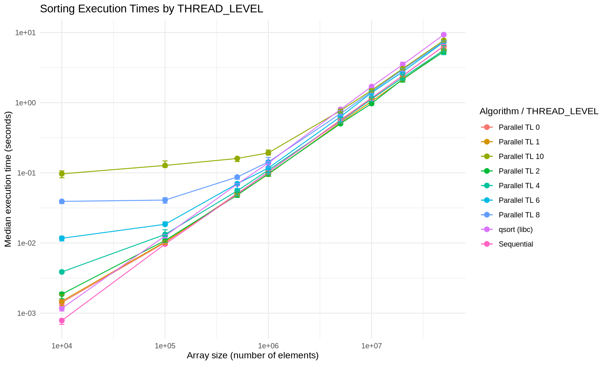

# Analyse des performances

## 1. Configuration expérimentale

Les benchmarks ont été réalisés sous **Linux dans WSL2** sur une machine équipée d'un **AMD Ryzen 7 6800HS Creator Edition**. WSL2 expose 8 cœurs physiques et 16 processeurs logiques. La mémoire visible est de 6,6 Gio, avec 2 Gio de swap. Le programme a été compilé avec **GCC 16.2.0** et les options `-O2 -Wall -g`.

Le benchmark compare trois méthodes de tri : le tri séquentiel, notre implémentation de tri parallèle et `qsort` fourni par la bibliothèque standard C.

Pour le tri parallèle, plusieurs niveaux de récursion ont été testés :

```text
THREAD_LEVEL = 0, 1, 2, 4, 6, 8, 10
```

Chaque configuration a été exécutée **10 fois** sur des tableaux de 10 000 à 50 millions d'éléments. Les résultats sont analysés à partir des médianes et d'intervalles de confiance bootstrap à 95 %.

## 2. Fichiers ajoutés

### Benchmark

- `scripts/benchmark_improved.sh` : lance automatiquement les benchmarks pour les différentes tailles, les niveaux de `THREAD_LEVEL` et le nombre de répétitions.
- `src/parallelQuicksort.c` : permet de définir la taille du tableau et le `THREAD_LEVEL` directement depuis la ligne de commande.

### Analyse statistique

- `scripts/analyse_benchmark.R` : calcule les médianes, les intervalles de confiance bootstrap à 95 %, les speedups et le meilleur `THREAD_LEVEL`.
- `data/benchmark_*.csv` : contient les mesures brutes produites par les benchmarks.
- `data/analysis/statistiques_thread_level.csv` : contient les statistiques calculées pour chaque taille et chaque `THREAD_LEVEL`.
- `data/analysis/best_thread_level.csv` : contient le meilleur `THREAD_LEVEL` identifié pour chaque taille.

### Visualisations

- `data/analysis/execution_times_thread_levels.png` : comparaison des temps d'exécution.
- `data/analysis/parallel_thread_levels.png` : évolution des performances du tri parallèle selon `THREAD_LEVEL`.
- `data/analysis/speedup_thread_levels.png` : évolution du speedup selon la taille du tableau et le `THREAD_LEVEL`.

Les fichiers CSV et les graphiques sont générés automatiquement à partir des mesures du benchmark.

## 3. Lancement du benchmark

Le benchmark est lancé avec le nombre de répétitions souhaité :

```bash
./scripts/benchmark_improved.sh 10
```

Le fichier CSV généré est ensuite utilisé pour l'analyse :

```bash
Rscript scripts/analyse_benchmark.R data/benchmark_20261111_180819.csv
```

Le script calcule les médianes, les intervalles de confiance bootstrap à 95 %, les speedups et le meilleur `THREAD_LEVEL` pour chaque taille.

## 4. Analyse des temps d'exécution



*Figure 1 - Temps d'exécution du tri séquentiel, du tri parallèle et de `qsort`.*

Le temps d'exécution augmente naturellement avec la taille du tableau. Pour les petites tailles, les différentes méthodes restent relativement proches : le travail à effectuer est faible et le coût de gestion du parallélisme devient proportionnellement important.

Lorsque la taille augmente, l'intérêt du parallélisme devient plus visible. Le niveau de récursion joue cependant un rôle important : augmenter `THREAD_LEVEL` ne garantit pas une meilleure performance. Un niveau trop élevé peut générer davantage de tâches que nécessaire et augmenter le coût de création, de synchronisation et de gestion des threads.

La comparaison montre donc qu'il existe un compromis entre la quantité de travail parallèle et l'overhead introduit par celui-ci.

## 5. Influence de `THREAD_LEVEL`


*Figure 2 - Temps d'exécution du tri parallèle pour les différents niveaux de `THREAD_LEVEL`.*

Les résultats montrent que le meilleur niveau dépend de la taille du tableau. Pour les petites tailles, `THREAD_LEVEL = 1` est préférable, tandis que `THREAD_LEVEL = 2` devient le meilleur choix à partir de 500 000 éléments.

| Taille     | Meilleur `THREAD_LEVEL`|Speedup|
| 10 000     |      1                 | 0,584 |
| 100 000    |      1                 | 0,940 |
| 500 000    |      2                 | 1,064 |
| 1 000 000  |      2                 | 1,077 |
| 5 000 000  |      2                 | 1,114 |
| 10 000 000 |      2                 | 1,172 |
| 20 000 000 |      2                 | 1,154 |
| 50 000 000 |      2                 | 1,221 |

Cette évolution s'explique par le compromis entre **parallélisme exploitable** et **coût de gestion**. Pour un petit tableau, multiplier les tâches apporte peu de bénéfice. Pour un grand tableau, le travail disponible est suffisamment important pour amortir cet overhead.

## 6. Speedup


*Figure 3 - Speedup du tri parallèle par rapport au tri séquentiel.*

Le speedup est calculé par :

```text
speedup = temps séquentiel / temps parallèle
```

La valeur `1` correspond donc à une performance identique entre les deux méthodes. Une valeur supérieure à `1` indique une accélération du tri parallèle.

Pour 10 000 éléments, le meilleur speedup est seulement de **0,584** avec `THREAD_LEVEL = 1`. Le parallélisme est donc défavorable pour cette taille. À 100 000 éléments, le speedup atteint **0,940**, ce qui montre que le parallèle se rapproche du séquentiel sans encore le dépasser.

À partir de 500 000 éléments, le comportement change : le meilleur speedup devient supérieur à `1` et `THREAD_LEVEL = 2` est systématiquement sélectionné.

Le meilleur résultat est obtenu pour 50 millions d'éléments :

| Taille     | `THREAD_LEVEL` | Speedup médian | IC 95 % |
| 500 000    | 2              | 1,064          | [1,009 ; 1,094] |
| 1 000 000  | 2              | 1,077          | [1,056 ; 1,105] |
| 5 000 000  | 2              | 1,114          | [1,082 ; 1,149] |
| 10 000 000 | 2              | 1,172          | [1,119 ; 1,232] |
| 20 000 000 | 2              | 1,154          | [1,107 ; 1,203] |
| 50 000 000 | 2              | 1,221          | [1,157 ; 1,311] |

Pour 50 millions d'éléments, le speedup médian de **1,221** correspond à une accélération d'environ **22 %** par rapport au tri séquentiel. L'intervalle de confiance est entièrement supérieur à `1`, ce qui va dans le sens d'un gain réel dans cette configuration.

À l'inverse, les intervalles de confiance des tailles 10 000 et 100 000 restent entièrement inférieurs à `1`. Le parallélisme n'est donc pas avantageux pour ces tailles.

## 7. Comparaison avec `qsort`

Le benchmark permet également de comparer notre implémentation parallèle à `qsort`, la fonction de tri fournie par la bibliothèque standard C.


*Figure 4 - Comparaison des temps d'exécution des différentes méthodes.*

Pour les grandes tailles, le tri parallèle devient compétitif face à `qsort` et peut être plus rapide selon la configuration utilisée. Cette comparaison doit cependant être interprétée dans le contexte de notre environnement expérimental : les performances de `qsort` dépendent notamment de l'implémentation de la bibliothèque C, du compilateur, de l'architecture et des options de compilation.

L'objectif principal de cette expérience reste donc la comparaison entre notre version séquentielle et notre version parallèle, tandis que `qsort` constitue une référence supplémentaire.

## 8. Fiabilité des mesures

Les résultats sont basés sur **10 répétitions par configuration**, ce qui permet d'obtenir une estimation plus robuste que les premiers essais réalisés avec moins de répétitions.

Les intervalles de confiance à 95 % indiquent la précision de la médiane calculée à partir des mesures. Ils permettent d’estimer l’incertitude liée aux résultats obtenus.

Les résultats restent néanmoins dépendants de la machine utilisée, de WSL2, de la charge du système et des choix d'implémentation.

## 9. Conclusion

L'expérience montre que le parallélisme n'est intéressant que lorsque la quantité de travail est suffisamment importante pour amortir son coût de gestion.

Pour 10 000 et 100 000 éléments, le tri séquentiel reste préférable